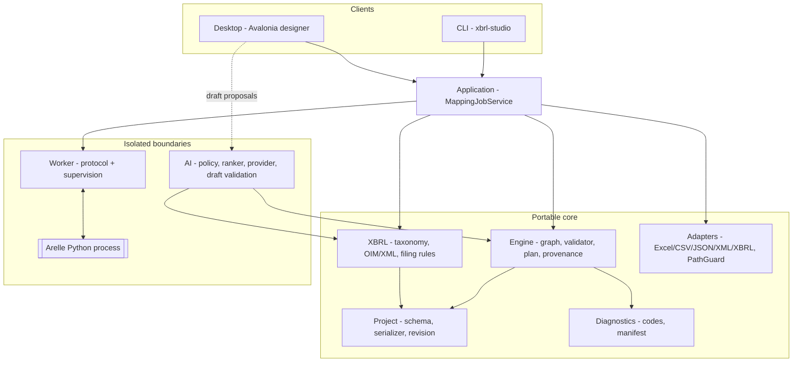

# XBRL Mapping Studio

An offline-capable desktop designer, a portable deterministic execution engine, and a
headless CLI for turning workbooks, files and databases into validated XBRL (Open
Information Model) reports — with every emitted fact traceable to its source.

---

## Table of contents

- [What it does](#what-it-does)
- [Architecture](#architecture)
- [Technology stack](#technology-stack)
- [Repository layout](#repository-layout)
- [Getting started](#getting-started)
- [Building and testing](#building-and-testing)
- [Command-line reference](#command-line-reference)
- [Testing](#testing)
- [CI/CD](#cicd)
- [Implementation status](#implementation-status)
- [Owner-gated decisions](#owner-gated-decisions)
- [Design principles](#design-principles)
- [Contributing](#contributing)

---

## What it does

A reporting analyst's workflow starts with a source (Excel workbook, CSV, JSON, XML, or a
saved XBRL report) and ends with a validated deliverable whose individual facts can be
traced back to their origin. The **same saved mapping** runs interactively in the designer
and unattended in the CLI, producing semantically equivalent output.

Core capabilities implemented here:

- **Visual mapping** — drag-and-drop node graph with typed input/output ports, multi-select,
  reconnection, delete, and undo/redo. Layout changes never bump the semantic revision.
- **Deterministic transformation** — a topologically-sorted, cancellable execution plan with
  provenance recorded on every fact.
- **XBRL generation & validation** — serialization to xBRL-JSON and xBRL 2.1 XML, taxonomy
  concept search, dimensions, compound units, multilingual labels, and filing-rule validation.
  Filing-profile identity fails closed: a project whose `ProfileId`/`ProfileDigest` does not
  match the resolved profile is rejected with a blocking `XBR015` diagnostic before any
  source read or worker call. Each profile declares its required checks; a check that never
  fires (for example, an empty fact set) is recorded as `XBR014` and resolves the run to
  incomplete rather than a silent success.
- **Durable AI06 audit trail** — every accept/edit/reject/batch/undo decision persists to
  the versioned `suggestion_audit` table with governed actor, method, prompt-template
  revision and bounded original/approved payloads; a broken sink is captured on
  `AuditLog.PersistenceFaults` and cannot block the analyst.
- **Report re-import** — an XBRL instance can be read back as records and remapped.
- **Adapters** — Excel (read/write), CSV, JSON (read/write), XML (read/write), and XBRL
  report input, each behind a capability-gated, direction-checked interface. `MappingJobService`
  surfaces target and source suitability (IO01) so the designer can disable a read-only
  connector before a user starts mapping.
- **SQLite input and publishing** — table discovery, schema inspection, bounded preview,
  and shared-engine execution. Provenance uses a stable SHA-256 row identity derived from
  declared single or composite primary keys; keyless tables use positional provenance with
  an `IO015` warning. A saved destination plan can publish XBRL fact rows through the CLI
  or desktop after schema review, current approval, and explicit confirmation, with a
  transactional upsert and durable receipt. The supported target is the versioned
  `xbrl-facts-v1` contract; broader table mapping and production database qualification remain open.
- **Local operational state** — a versioned SQLite application database holds the run
  journal and publication receipts, with non-overwriting online-backup support.
- **AI-assisted mapping (offline-safe)** — deterministic local retrieval proposes concept
  candidates; an analyst accepts/edits/rejects them in a draft before anything becomes
  executable. Under the `Offline` data policy the service is structurally incapable of any
  outbound network call.
- **Unattended operations** — destination locking with atomic replace, private staging, run
  journal with crash recovery, worker supervision (flood bounding, watchdog kill, orphan
  check) with distinct terminal outcomes for cancellation, timeout and crash (`WKR004` /
  `WKR003`), workspace path guard, and redacted support bundles.

---

## Architecture

Portable logic is separated from I/O, UI, and the Python worker so preview, full execution,
and scheduled execution share one implementation.



**Trust boundaries**

| Boundary | Rule |
|---|---|
| `Engine` | Portable C#. No UI, Python, or disk dependencies. |
| Adapters | Reached only through `ISourceAdapter` / `ITargetAdapter` with declared capabilities and a read/write direction gate. |
| Worker | Reached only through `IWorkerClient`; Arelle runs as a separate Python process, isolated for crashes/cancellation. |
| Application | `MappingJobService` is the single job pipeline consumed by both CLI and Desktop. |
| AI | Suggestions mutate only a draft; offline mode replaces the provider with a null object so no transport can be reached. |

---

## Technology stack

| Component | Choice | Notes |
|---|---|---|
| Runtime / SDK | **.NET 10 LTS** (`net10.0`, SDK 10.0.300) | Solution uses the `.slnx` format. |
| Language | C# 14 (`LangVersion` pinned in `Directory.Build.props`), nullable enabled | |
| Desktop UI | **Avalonia 11.1** | The guide's 12.1.5 + Nodify.Avalonia baseline does not restore in this environment; a custom `GraphCanvas` is used. Revisit at hardware/installer qualification. |
| Excel | ClosedXML 0.104.2 | |
| Data formats | `System.Text.Json`, `System.Xml` | XML parsed with `DtdProcessing.Prohibit` and `XmlResolver = null`. |
| XBRL | Synthetic OIM profile (`urn:synthetic:finance:1.0`) | No real regulator taxonomy is available offline. |
| Local state | `Microsoft.Data.Sqlite` | Versioned app database (`state.db`): run journal, publication receipts, backups. |
| XBRL validation worker | Python 3.12 + Arelle (`tools/worker/`) | Hash-locked requirements; offline CI validation against a checked-in synthetic taxonomy. |
| Tests | xUnit 2.9.3 | Exact-head CI [42409129339](https://github.com/nirzaf/XBRLMappingStudio/actions/runs/42409129339) verified commit `03106e837d094f4a8feda572e8668bae01a95543`: Windows and Ubuntu each passed 858 tests with 6 environment-gated Arelle subprocess skips; the pinned worker job passed 72 Python tests and 15 gated .NET Arelle tests. |
| CI/CD | GitHub Actions | See [CI/CD](#cicd). |

---

## Repository layout

```
XBRLMappingStudio.slnx
src/
  XBRLMappingStudio.Engine/        # portable graph, validation, plan, provenance
  XBRLMappingStudio.Project/       # project schema, serializer, semantic revision, manager
  XBRLMappingStudio.Diagnostics/   # diagnostic contract, stable codes, run manifest
  XBRLMappingStudio.XBRL/          # taxonomy index, OIM/XML serialization, filing rules
  XBRLMappingStudio.Adapters/      # Excel/CSV/JSON/XML/XBRL adapters, PathGuard
  XBRLMappingStudio.Application/   # MappingJobService, locking, publication, local state DB, support bundle
  XBRLMappingStudio.AI/            # policy, retrieval ranker, providers, draft validation
  XBRLMappingStudio.Worker/        # worker protocol, Arelle client, supervision
  XBRLMappingStudio.Desktop/       # Avalonia designer
  XBRLMappingStudio.CLI/           # xbrl-studio headless runner
tests/
  XBRLMappingStudio.*.Tests/       # per-subsystem suites
  XBRLMappingStudio.Fixtures/      # shared test fixtures (workbooks, projects)
docs/
  implementation-status.md         # capability matrix with per-item evidence and limits
  sqlite-state.md                  # local SQLite state, source and target behavior
  decisions/
    BASE01-decision-record.md      # dated decision record (synthetic column filled)
    OPEN.md                        # owner-gated decision register
tools/worker/
  arelle_worker.py                 # Arelle validation worker (protocol + offline tests)
  requirements.lock                # hash-locked Python runtime
```

---

## Getting started

**Prerequisites**

- [.NET 10 SDK](https://dotnet.microsoft.com/download/dotnet/10.0) (10.0.300 or later)
- Git

**Clone & build**

```bash
git clone https://github.com/nirzaf/XBRLMappingStudio.git
cd XBRLMappingStudio
dotnet build XBRLMappingStudio.slnx -c Release
```

**Run the designer**

```bash
dotnet run --project src/XBRLMappingStudio.Desktop
```

**Run the CLI**

```bash
dotnet run --project src/XBRLMappingStudio.CLI -- --help
```

---

## Building and testing

```bash
# Full solution, Release
dotnet build XBRLMappingStudio.slnx -c Release

# All tests
dotnet test XBRLMappingStudio.slnx -c Release

# One subsystem
dotnet test tests/XBRLMappingStudio.Engine.Tests -c Release
```

Publish a self-contained CLI (no separate .NET install required):

```bash
dotnet publish src/XBRLMappingStudio.CLI -c Release -r win-x64  --self-contained true -o publish/cli
dotnet publish src/XBRLMappingStudio.CLI -c Release -r linux-x64 --self-contained true -o publish/cli
dotnet publish src/XBRLMappingStudio.CLI -c Release -r osx-x64  --self-contained true -o publish/cli
```

---

## Command-line reference

`xbrl-studio` shares the exact engine, adapters, and project format the designer uses.
Standard output carries machine-readable results; standard error carries diagnostics.
Commands that use the built-in synthetic taxonomy require `--allow-synthetic-profile`;
this development opt-in does not qualify a regulator profile.

| Command | Purpose |
|---|---|
| `inspect <project.xmap>` | Print the project's bound sources and schemas. |
| `inspect-source <project.xmap> [--binding <id>]` | Inspect the selected SQLite source schema and capabilities. |
| `validate <project.xmap> [--allow-synthetic-profile]` | Run graph validation; the built-in development profile requires explicit opt-in. |
| `configure-destination <project.xmap> ...` | Save a CSV, Excel, JSON, XML, or existing SQLite target plan; use `--kind`, `--path`, and the matching format/table/key options shown by `--help`. |
| `preview <project.xmap> --binding <id>=<path> --rows <n> [--allow-synthetic-profile] [--arelle ...]` | Sampled, visibly-partial execution. |
| `execute <project.xmap> --binding <id>=<path> --output <path> [--output-format xbrl-json|xbrl-xml] [--workspace-root <dir>] [--allow-synthetic-profile] [--arelle ...]` | Full run producing xBRL-JSON by default, or xBRL-XML when explicitly selected. The publisher validates the exact staged bytes with the selected profile worker before replacing the destination; XML publication currently requires an in-memory full run and cannot be combined with `--publish-destination`. Source, output, and manifest paths stay inside the workspace root. |
| `execute <project.xmap> --binding <id>=<path> --publish-destination [--allow-synthetic-profile] [--arelle ...]` | Publish the saved destination plan (file or SQLite). With a saved SQLite plan, `--output <path>` enables independently journaled xBRL-JSON + SQLite publication; different existing file bytes are never replaced, and partial outcomes can be reconciled by operation key. |
| `reconcile-publication <mixed-operation-key>` | Read the saved file digest and SQLite receipt, update per-destination outcomes, and report confirmed, rejected, or unknown state without publishing. |
| `taxonomy-search [--allow-synthetic-profile] [--query <text>] [--lang <tag>] [--page <n>] [--size <n>]` | Paged concept search against the synthetic development taxonomy. |
| `validate-artifact <file.xbrl.json> [--allow-synthetic-profile]` | Local filing-rule validation requires the explicit development-profile flag; add `--arelle --python <exe> --taxonomy-root <dir>` (optionally `--package <zip>`, `--plugin <name>`, `--disclosure-system <name>`) for independent offline Arelle validation. Install the pinned worker runtime from `tools/worker/requirements.lock`. |
| `inspect-run-result <runId>` | Look up a run's journal result. |
| `support-bundle <project.xmap> <runId> [--out <path>] [--log <file>]` | Redacted diagnostic bundle. |

For `--arelle`, optional worker settings are `--python <exe>` and
`--taxonomy-root <dir>`. The CLI requires these settings to be used with `--arelle`.

**Exit codes**

| Code | Meaning |
|---|---|
| 0 | Success |
| 1 | Success with warnings |
| 2 | Invalid mapping |
| 3 | Data error |
| 4 | Incomplete profile / configuration |
| 5 | Authorization failure |
| 6 | Cancelled |
| 7 | Operational failure |

Example:

```bash
dotnet run --project src/XBRLMappingStudio.CLI -- \
  execute my.xmap --binding wb=Quarterly.xlsx --output out.json --allow-synthetic-profile
echo $?   # 0 on success, 2 on invalid mapping, ...
```

---

## Testing

The captured baseline run [42192658514](https://github.com/nirzaf/XBRLMappingStudio/actions/runs/42192658514) verified source commit `563f74d260af0a0f5e5066db11f135814d1ddbec`: repository hygiene and the Windows/Ubuntu Release build/test matrix passed. Each .NET matrix passed **612 tests** and skipped **5** Arelle-gated subprocess cases, with no failures. The pinned worker job passed **46 Python tests** and **11 .NET Arelle execution tests**, including all 5 gated cases. Its historical per-suite totals remain in [`docs/verification-baseline-2026-11-06.md`](docs/verification-baseline-2026-11-06.md).

The compound-unit slice run [42308787441](https://github.com/nirzaf/XBRLMappingStudio/actions/runs/42308787441) verified exact source commit `2887939e0be99c710faa6aa973337b7d81c671e5`: repository hygiene, Windows and Ubuntu Release build/test, pinned worker integration, dependency inventory, and SPDX generation all passed. Each .NET OS matrix passed **747 tests** and skipped **5** environment-gated Arelle subprocess cases. The pinned worker job passed all **11** gated .NET Arelle execution tests. Local verification passed the same eight-project suite: **747 passed, 0 failed, 5 skipped**; the skipped cases require the pinned Arelle subprocess runtime.

The profile-aware XML QName round-trip run [42311840089](https://github.com/nirzaf/XBRLMappingStudio/actions/runs/42311840089) verified exact source commit `70ca4c1f8f491ab29fd1a8caccb4dea0f45217be`: repository hygiene, Windows and Ubuntu Release build/test, pinned worker integration, dependency inventory, and SPDX generation all passed. Each .NET OS matrix passed **748 tests** and skipped **5** environment-gated Arelle subprocess cases; the pinned worker job passed all **11** gated .NET Arelle execution tests. The local Release build completed with 0 warnings and errors, and all eight .NET projects passed **748 tests** with the same 5 Arelle-gated skips.

The OPS-02 hostile-path and worker-failure publication regressions are included in commit `03106e837d094f4a8feda572e8668bae01a95543`; exact-head CI [42409129339](https://github.com/nirzaf/XBRLMappingStudio/actions/runs/42409129339) passed on Windows and Ubuntu, with pinned Arelle integration and repository hygiene also passing. Coverage verifies literal handling of hostile worker paths/arguments and that timeout or crash cannot replace a prior report. The two-process worker limit is shared within one application process; the broader implementation status and qualification gates are recorded in [`docs/implementation-status.md`](docs/implementation-status.md).

The exact-head CI run [42409129339](https://github.com/nirzaf/XBRLMappingStudio/actions/runs/42409129339) verified source commit `03106e837d094f4a8feda572e8668bae01a95543`. Repository hygiene, Release build/test on Windows and Ubuntu, pinned Arelle integration, dependency-inventory tests, and SPDX generation all passed. Each .NET OS matrix passed **858 tests, skipped 6 environment-gated Arelle cases, and had 0 failures**; per-project counts are listed below. The separate worker job passed **72 Python protocol/offline tests** and **15 gated .NET Arelle execution tests**; the dependency-inventory generator passed **15 Python tests**.

| Suite | Count | Covers |
|---|---:|---|
| Engine.Tests | 121 | Validation, plan compilation, collections/joins/functions, preview reconciliation, determinism, cancellation, GroupBy resource caps, set-collected text and compound-unit facts |
| XBRL.Tests | 114 | Taxonomy index, dimensions and compound units, xBRL-JSON↔XML equivalence, report re-import, QName alias normalization, filing rules, conversion resilience, required-check completeness |
| AI.Tests | 72 | Zero-outbound policy, deterministic retrieval, provider contract, draft validation, analyst workflow, in-memory and durable audit sink (AI06) |
| Adapters.Tests | 94 | XLSX input/output and drift policies, CSV/JSON/XML round-trips and hardening, staged writers, SQLite snapshot under WAL writes, destination schema inspection, PK identity and target upsert |
| Ops.Tests | 89 | Destination locking/publication/journal, exact staged validation and tamper recovery, local database migrations and backups, durable suggestion audit, worker supervision, path guard, redaction |
| Integration.Tests | 239 passed; 6 gated skips | CLI parity, cross-format acceptance oracles, destination workflows, staged report validation, preserved output on incomplete validation, disabled-profile gates, bounded large-run preflight/finalization and worker failures |
| Desktop.Tests | 103 | Project lifecycle, graph editing and transforms, source/target review, destination dry run and publication, disabled-profile preview blocking, suggestion review and audit persistence |
| Project.Tests | 26 | Atomic save, backward-compatible destination persistence, revision conflict and semantic digest |

```bash
dotnet test XBRLMappingStudio.slnx -c Release
```

---

## CI/CD

Two GitHub Actions workflows under `.github/workflows/`:

- **[`ci.yml`](./.github/workflows/ci.yml)** — on pull requests and pushes to `main`:
  Release build + full test suite on **ubuntu-latest** and **windows-latest**, an
  **Arelle worker** job that installs the hash-locked Python runtime and runs the worker's
  protocol/offline-taxonomy tests, plus a hygiene job that rejects tracked `bin/`/`obj/`
  output and any edit to the architecture guide.
- **[`release.yml`](./.github/workflows/release.yml)** — on `vX.Y.Z` tags (or manual
  dispatch): gates on build + test, publishes self-contained CLI binaries
  (win/linux/mac) and portable desktop bundles, then opens a **draft GitHub Release**.

> **Release scope:** signed Windows installers and locked/signed release bundles are
> owner-gated (guide IDs `UI07`, `OPS06`/`OPS07`). The pipeline produces **unsigned,
> portable** artifacts only and does not claim code-signing.

To cut a release:

```bash
git tag v1.0.0 && git push origin v1.0.0
```

---

## Implementation status

Capabilities are tracked by stable guide IDs and delivery gates in
[`docs/implementation-status.md`](./docs/implementation-status.md). This summary
reports evidence-backed subsets; the tracker retains all 67 original guide IDs.
An interface or passing unit test alone does not complete a guide ID:

| Area | Verified subset | Still open |
|---|---|---|
| Foundation | `BASE02`–`BASE04`; `BASE01` synthetic development boundary | Customer rights and production profile decisions |
| Mapping engine | `MAP01`; `MAP02` for supported graph shapes | `MAP03`–`MAP08` remain partial for resource budgets, reusable functions and provenance drill-down |
| Adapters | `IO02`–`IO06` for documented subsets; `IO01` and SQLite `IO07`–`IO08` partial | Production database connectors `IO09`, PDF/OCR `IO10`–`IO12`, and stronger snapshot/reconciliation qualification |
| XBRL | `XBR05` for supported constructs; `XBR07` on the synthetic profile; `XBR08` for tested worker outcomes; exact staged xBRL-JSON validation before file publication | Profile-wide aspects, xBRL-XML output publication and real filing acceptance; `XBR09` remains owner-gated |
| Desktop | `UI02` for supported graph editing; `UI06` local suggestion-review workflow | Full lifecycle, real-profile workflow, accessibility and signed-installer qualification |
| AI baseline | `AI01` offline policy, `AI02` local synthetic retrieval, `AI06` durable local audit | `AI03`–`AI05` partial; independent evaluation and controlled rollout `AI07`–`AI08` missing |
| Operations | `OPS01` for supported inputs; `OPS02` for file publication | `OPS03`–`OPS09` remain partial for authority, reconciliation, packaging, recovery and retention |
| Performance | None qualified | `PERF01`–`PERF07` need approved hardware and measured evidence |

SQLite and CSV/XLSX/JSON/XML destinations are wired through shared application
services and CLI/Desktop workflows. Mixed-destination receipt reconciliation,
ambiguous-commit recovery and production database qualification remain incomplete.
SQLite source rows with declared single or composite primary keys receive deterministic
SHA-256 hashed row identities used for provenance; the schema inspector exposes
declared primary-key order. A table without a primary key keeps positional provenance and
produces an `IO015` warning; SQLite does not guarantee row ordering between reads. The
run manifest records which row-identity strategy was used, and the desktop binding UI
discloses the key configuration.

Filing-profile identity is fail-closed: `validate`, `preview` and `execute` compare the
project's `ProfileId`/`ProfileDigest` against the resolved profile and stop with a blocking
`XBR015` diagnostic — before any graph compilation, source read, or worker call — on
mismatch (`tests/XBRLMappingStudio.Integration.Tests/ProfileIdentityTests.cs`).

Local operational state lives in a versioned SQLite application database (`app_settings`,
`project_registry`, `run_journal`, `publication_receipts`, `suggestion_audit`); `.xmap`
remains the portable source of truth for executable graphs. See
[`docs/sqlite-state.md`](./docs/sqlite-state.md).

Per-ID evidence lives in [`docs/decisions/BASE01-decision-record.md`](./docs/decisions/BASE01-decision-record.md).
Items marked "synthetic" (e.g. the XBRL filing profile) are honestly scoped to the offline
synthetic OIM profile — they are **not** qualified against a real regulator package.
CLI and Desktop resolve saved profile identity and share the fail-closed worker factory;
non-synthetic profiles remain unavailable until their owner-approved qualification gate
closes. Authorized xBRL-JSON file publication validates the exact staged bytes through
that profile worker, rechecks their digest before replacement, and records matching
validated and published digests. The synthetic profile uses the local worker by default,
while the CLI Arelle path is covered by the dedicated offline integration job. Desktop
headless tests and a bounded native smoke support specific workflows, not full Windows
acceptance. Narrator, native
dialog and installer behavior remain unqualified. AI review persists local decisions
durably, but the local OS actor is not an organizational reviewer authority, and batch
review/evaluation remain open.

---

## Owner-gated decisions

The following require commitments outside this development environment and are documented,
not silently re-scoped. See [`docs/decisions/OPEN.md`](./docs/decisions/OPEN.md):

- First filing **jurisdiction**, target **production taxonomy**, **model provider**, and
  **data-residency** agreement (`BASE01`).
- Production database family qualification (`IO07`–`IO09`) and PDF/OCR ingestion (`IO10`–`IO12`).
- Real regulator profile + taxonomy upgrade simulation (`XBR09`).
- Model-provider qualification and rollout (`AI07`–`AI08`).
- Keyboard/screen-reader qualification (`UI05`), signed Windows installer (`UI07`) and
  real Windows performance benchmarks (`PERF01`–`PERF07`).
- Signed release bundles and upgrade/backup/rollback (`OPS06`–`OPS07`), and
  regulator-mandated extensions (`EXT01`–`EXT04`).

See [`docs/sqlite-state.md`](./docs/sqlite-state.md) for SQLite behavior and limits, and
[`docs/implementation-status.md`](./docs/implementation-status.md) for the full status matrix.

---

## Design principles

These are held invariant across the codebase:

- The **portable `Engine`** has no UI, Python, or disk dependencies.
- Adapters are isolated behind `ISourceAdapter` / `ITargetAdapter`; the worker behind
  `IWorkerClient`.
- A single **`Application.MappingJobService`** is consumed by both CLI and Desktop.
- **Stable diagnostic codes** — never reused — namespaced by prefix (`MAP`/`PRJ`/`IO`/`XBR`/`WKR`/`PUB`/`AI`/`UI`).
- **Semantic revision is independent of layout**: moving a node on the canvas must not change
  the project's semantic digest.
- Execution is **deterministic and cancellable**, with **provenance on every emitted fact**.
- Safety gates **fail closed**: stale schemas, mismatched filing profiles, and unproven
  output digests stop the run before any side effect.
- No `bin/`/`obj/` output is committed.

---

## Contributing

1. Create a feature branch from `main`.
2. Add or update tests before changing shared behavior — CI runs the whole suite on Linux
   and Windows.
3. Keep the architecture boundaries and stable-diagnostic-code rules intact.
4. Record behavior- and scope-changing decisions as dated entries in `docs/decisions/`.
5. Open a pull request; CI must be green before review.

---

## License

**No `LICENSE` file has been declared in this repository yet.** Until one is added, the
source should be treated as proprietary and all rights reserved by the project owner.

Third-party components remain under their own licenses — notably Avalonia (MIT),
ClosedXML (MIT), and, where used, Arelle (Apache 2.0). Consult the pinned dependency
baseline for licensing and redistribution obligations before shipping a release.
