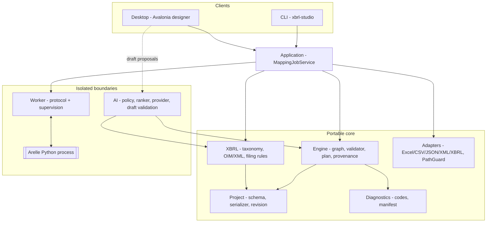

# XBRL Mapping Studio

An offline-capable desktop designer, a portable deterministic execution engine, and a
headless CLI for turning workbooks, files and databases into validated XBRL (Open
Information Model) reports — with every emitted fact traceable to its source.

> This repository is an implementation of
> [`XBRL_Mapping_Studio_Architecture_and_Implementation_Guide.md`](./XBRL_Mapping_Studio_Architecture_and_Implementation_Guide.md),
> which is the **authoritative, read-only** specification. The guide defines the product
> boundary, runtime/trust boundaries, and per-ID acceptance criteria delivered here.

---

## Table of contents

- [What it does](#what-it-does)
- [Architecture](#architecture)
- [Technology stack](#technology-stack)
- [Repository layout](#repository-layout)
- [Getting started](#getting-started)
- [Building and testing](#building-and-testing)
- [Command-line reference](#command-line-reference)
- [Testing](#testing)
- [CI/CD](#cicd)
- [Implementation status](#implementation-status)
- [Owner-gated decisions](#owner-gated-decisions)
- [Design principles](#design-principles)
- [Contributing](#contributing)

---

## What it does

A reporting analyst's workflow starts with a source (Excel workbook, CSV, JSON, XML, or a
saved XBRL report) and ends with a validated deliverable whose individual facts can be
traced back to their origin. The **same saved mapping** runs interactively in the designer
and unattended in the CLI, producing semantically equivalent output.

Core capabilities implemented here:

- **Visual mapping** — drag-and-drop node graph with typed input/output ports, multi-select,
  reconnection, delete, and undo/redo. Layout changes never bump the semantic revision.
- **Deterministic transformation** — a topologically-sorted, cancellable execution plan with
  provenance recorded on every fact.
- **XBRL generation & validation** — serialization to xBRL-JSON and xBRL 2.1 XML, taxonomy
  concept search, dimensions, compound units, multilingual labels, and filing-rule validation.
- **Report re-import** — an XBRL instance can be read back as records and remapped.
- **Adapters** — Excel (read/write), CSV, JSON, XML, and XBRL report input, each behind a
  capability-gated, direction-checked interface.
- **AI-assisted mapping (offline-safe)** — deterministic local retrieval proposes concept
  candidates; an analyst accepts/edits/rejects them in a draft before anything becomes
  executable. Under the `Offline` data policy the service is structurally incapable of any
  outbound network call.
- **Unattended operations** — destination locking with atomic replace, private staging, run
  journal with crash recovery, worker supervision (flood bounding, watchdog kill, orphan
  check), workspace path guard, and redacted support bundles.

---

## Architecture

Portable logic is separated from I/O, UI, and the Python worker so preview, full execution,
and scheduled execution share one implementation.



**Trust boundaries**

| Boundary | Rule |
|---|---|
| `Engine` | Portable C#. No UI, Python, or disk dependencies. |
| Adapters | Reached only through `ISourceAdapter` / `ITargetAdapter` with declared capabilities and a read/write direction gate. |
| Worker | Reached only through `IWorkerClient`; Arelle runs as a separate Python process, isolated for crashes/cancellation. |
| Application | `MappingJobService` is the single job pipeline consumed by both CLI and Desktop. |
| AI | Suggestions mutate only a draft; offline mode replaces the provider with a null object so no transport can be reached. |

---

## Technology stack

| Component | Choice | Notes |
|---|---|---|
| Runtime / SDK | **.NET 10 LTS** (`net10.0`, SDK 10.0.300) | Solution uses the `.slnx` format. |
| Language | C# 14 (`LangVersion` pinned in `Directory.Build.props`), nullable enabled | |
| Desktop UI | **Avalonia 11.1** | The guide's 12.1.5 + Nodify.Avalonia baseline does not restore in this environment; a custom `GraphCanvas` is used. Revisit at hardware/installer qualification. |
| Excel | ClosedXML 0.104.2 | |
| Data formats | `System.Text.Json`, `System.Xml` | XML parsed with `DtdProcessing.Prohibit` and `XmlResolver = null`. |
| XBRL | Synthetic OIM profile (`urn:synthetic:finance:1.0`) | No real regulator taxonomy is available offline. |
| Tests | xUnit 2.9.3 | 181 tests across 8 projects. |
| CI/CD | GitHub Actions | See [CI/CD](#cicd). |

---

## Repository layout

```
XBRLMappingStudio.slnx
src/
  XBRLMappingStudio.Engine/        # portable graph, validation, plan, provenance
  XBRLMappingStudio.Project/       # project schema, serializer, semantic revision, manager
  XBRLMappingStudio.Diagnostics/   # diagnostic contract, stable codes, run manifest
  XBRLMappingStudio.XBRL/          # taxonomy index, OIM/XML serialization, filing rules
  XBRLMappingStudio.Adapters/      # Excel/CSV/JSON/XML/XBRL adapters, PathGuard
  XBRLMappingStudio.Application/   # MappingJobService, locking, publication, support bundle
  XBRLMappingStudio.AI/            # policy, retrieval ranker, providers, draft validation
  XBRLMappingStudio.Worker/        # worker protocol, Arelle client, supervision
  XBRLMappingStudio.Desktop/       # Avalonia designer
  XBRLMappingStudio.CLI/           # xbrl-studio headless runner
tests/
  XBRLMappingStudio.*.Tests/       # per-subsystem suites
  XBRLMappingStudio.Fixtures/      # shared test fixtures (workbooks, projects)
docs/decisions/
  BASE01-decision-record.md        # dated decision record (synthetic column filled)
  OPEN.md                          # owner-gated decision register
```

---

## Getting started

**Prerequisites**

- [.NET 10 SDK](https://dotnet.microsoft.com/download/dotnet/10.0) (10.0.300 or later)
- Git

**Clone & build**

```bash
git clone https://github.com/nirzaf/XBRLMappingStudio.git
cd XBRLMappingStudio
dotnet build XBRLMappingStudio.slnx -c Release
```

**Run the designer**

```bash
dotnet run --project src/XBRLMappingStudio.Desktop
```

**Run the CLI**

```bash
dotnet run --project src/XBRLMappingStudio.CLI -- --help
```

---

## Building and testing

```bash
# Full solution, Release
dotnet build XBRLMappingStudio.slnx -c Release

# All tests
dotnet test XBRLMappingStudio.slnx -c Release

# One subsystem
dotnet test tests/XBRLMappingStudio.Engine.Tests -c Release
```

Publish a self-contained CLI (no separate .NET install required):

```bash
dotnet publish src/XBRLMappingStudio.CLI -c Release -r win-x64  --self-contained true -o publish/cli
dotnet publish src/XBRLMappingStudio.CLI -c Release -r linux-x64 --self-contained true -o publish/cli
dotnet publish src/XBRLMappingStudio.CLI -c Release -r osx-x64  --self-contained true -o publish/cli
```

---

## Command-line reference

`xbrl-studio` shares the exact engine, adapters, and project format the designer uses.
Standard output carries machine-readable results; standard error carries diagnostics.

| Command | Purpose |
|---|---|
| `inspect <project.xmap>` | Print the project's bound sources and schemas. |
| `validate <project.xmap>` | Run graph validation; non-zero exit on blocking diagnostics. |
| `preview <project.xmap> --binding <id>=<path> --rows <n>` | Sampled, visibly-partial execution. |
| `execute <project.xmap> --binding <id>=<path> --output <path> [--workspace-root <dir>]` | Full run producing xBRL-JSON; all source, output and manifest paths stay inside the workspace root (defaults to the project directory). |
| `taxonomy-search [--query <text>] [--lang <tag>] [--page <n>] [--size <n>]` | Paged concept search. |
| `validate-artifact <file.xbrl.json>` | Synthetic filing-rule validation of the exported artifact. Add `--arelle --python <exe> --taxonomy-root <dir>` for independent offline Arelle validation; install the pinned worker runtime from `tools/worker/requirements.lock`. |
| `inspect-run-result <runId>` | Look up a run's journal result. |
| `support-bundle <project.xmap> <runId> [--out <path>] [--log <file>]` | Redacted diagnostic bundle. |

**Exit codes**

| Code | Meaning |
|---|---|
| 0 | Success |
| 1 | Success with warnings |
| 2 | Invalid mapping |
| 3 | Data error |
| 4 | Incomplete profile / configuration |
| 5 | Authorization failure |
| 6 | Cancelled |
| 7 | Operational failure |

Example:

```bash
dotnet run --project src/XBRLMappingStudio.CLI -- \
  execute my.xmap --binding wb=Quarterly.xlsx --output out.json
echo $?   # 0 on success, 2 on invalid mapping, ...
```

---

## Testing

181 tests across 8 xUnit projects, all green in Release:

| Suite | Count | Covers |
|---|---:|---|
| Engine.Tests | 33 | Validation, plan compilation, collections/joins/functions, preview reconciliation, determinism, cancellation |
| XBRL.Tests | 37 | Taxonomy index, dimensions/compound units, xBRL-JSON↔XML equivalence, report re-import, filing rules, conversion resilience |
| AI.Tests | 39 | Zero-outbound policy, deterministic retrieval, provider contract, draft validation, analyst workflow, audit |
| Adapters.Tests | 20 | XLSX output, CSV/JSON/XML round-trips and hardening |
| Ops.Tests | 24 | Destination locking/publication/journal, worker supervision, path guard, redaction |
| Desktop.Tests | 12 | Editing session: multi-select, reconnect, undo/redo, layout-vs-semantics |
| Integration.Tests | 10 | CLI parity (subprocess vs in-process), exit-code contract |
| Project.Tests | 6 | Atomic save, revision conflict, semantic digest |

```bash
dotnet test XBRLMappingStudio.slnx -c Release
```

---

## CI/CD

Two GitHub Actions workflows under `.github/workflows/`:

- **[`ci.yml`](./.github/workflows/ci.yml)** — on pull requests and pushes to `main`:
  Release build + full test suite on **ubuntu-latest** and **windows-latest**, plus a
  hygiene job that rejects tracked `bin/`/`obj/` output and any edit to the read-only
  architecture guide.
- **[`release.yml`](./.github/workflows/release.yml)** — on `vX.Y.Z` tags (or manual
  dispatch): gates on build + test, publishes self-contained CLI binaries
  (win/linux/mac) and portable desktop bundles, then opens a **draft GitHub Release**.

> **Release scope:** signed Windows installers and locked/signed release bundles are
> owner-gated (guide IDs `UI07`, `OPS06`/`OPS07`). The pipeline produces **unsigned,
> portable** artifacts only and does not claim code-signing.

To cut a release:

```bash
git tag v1.0.0 && git push origin v1.0.0
```

---

## Implementation status

The project is organized around the guide's atomic IDs and delivery gates (G0–G5). The
following IDs have implementation code and repository tests; qualification limits still apply:

| Area | Implemented IDs |
|---|---|
| Foundation | `BASE02`–`BASE04`, `BASE01` (synthetic column) |
| Mapping engine | `MAP01`–`MAP08` |
| Adapters | `IO01`–`IO06` |
| XBRL | `XBR01`–`XBR08` (synthetic profile; Arelle `validate-artifact` path) |
| Desktop | `UI01` (development build), `UI02` (canvas prototype), `UI03`–`UI04`, `UI06` (headless workflow tests) |
| AI baseline | `AI01`–`AI04`, `AI06` (offline baseline); `AI05` (single-suggestion apply/undo path) |
| Operations | `OPS01`–`OPS04`, `OPS08` (partial) |

Per-ID evidence lives in [`docs/decisions/BASE01-decision-record.md`](./docs/decisions/BASE01-decision-record.md).
Items marked "synthetic" (e.g. the XBRL filing profile) are honestly scoped to the offline
synthetic OIM profile — they are **not** qualified against a real regulator package.
Independent Arelle validation is available for existing artifacts through the CLI;
desktop and full `execute` runs still use the local synthetic validation worker.
Desktop tests exercise the view model and canvas session without a native Windows session;
keyboard-only use, screen-reader behavior, native dialogs and installer behavior remain
unqualified. AI review does not yet persist a governed reviewer identity and complete
accept/edit/reject/batch audit trail.

---

## Owner-gated decisions

The following require commitments outside this development environment and are documented,
not silently re-scoped. See [`docs/decisions/OPEN.md`](./docs/decisions/OPEN.md):

- First filing **jurisdiction**, target **production taxonomy**, **model provider**, and
  **data-residency** agreement (`BASE01`).
- Production database family (`IO07`–`IO09`) and PDF/OCR ingestion (`IO10`–`IO12`).
- Real regulator profile + taxonomy upgrade simulation (`XBR09`).
- Model-provider qualification and rollout (`AI07`–`AI08`).
- Keyboard/screen-reader qualification (`UI05`), signed Windows installer (`UI07`) and
  real Windows performance benchmarks (`PERF01`–`PERF07`).
- Signed release bundles and upgrade/backup/rollback (`OPS06`–`OPS07`), DB receipt lookup
  (`OPS05`), and regulator-mandated extensions (`EXT01`–`EXT04`).

---

## Design principles

These are held invariant across the codebase:

- The **portable `Engine`** has no UI, Python, or disk dependencies.
- Adapters are isolated behind `ISourceAdapter` / `ITargetAdapter`; the worker behind
  `IWorkerClient`.
- A single **`Application.MappingJobService`** is consumed by both CLI and Desktop.
- **Stable diagnostic codes** — never reused — namespaced by prefix (`MAP`/`PRJ`/`IO`/`XBR`/`WKR`/`PUB`/`AI`/`UI`).
- **Semantic revision is independent of layout**: moving a node on the canvas must not change
  the project's semantic digest.
- Execution is **deterministic and cancellable**, with **provenance on every emitted fact**.
- The architecture guide is **authoritative and read-only**; no `bin/`/`obj/` output is committed.

---

## Contributing

1. Create a feature branch from `main`.
2. Add or update tests before changing shared behavior — CI runs the whole suite on Linux
   and Windows.
3. Keep the architecture boundaries and stable-diagnostic-code rules intact.
4. Do not modify the architecture guide; propose changes through a dated entry in
   `docs/decisions/`.
5. Open a pull request; CI must be green before review.

---

## License

**No `LICENSE` file has been declared in this repository yet.** Until one is added, the
source should be treated as proprietary and all rights reserved by the project owner.

Third-party components remain under their own licenses — notably Avalonia (MIT),
ClosedXML (MIT), and, where used, Arelle (Apache 2.0). Consult the architecture guide's
dependency baseline for licensing and redistribution obligations before shipping a release.
